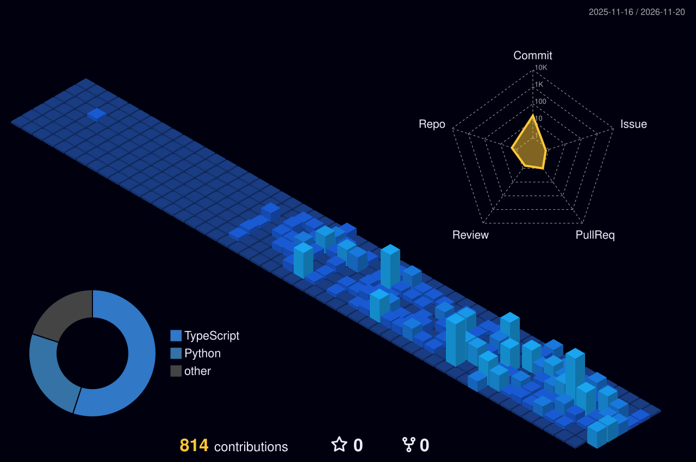
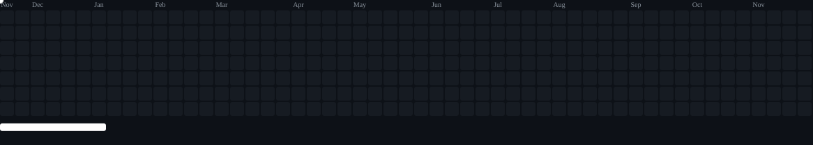

<div align="center">



<a href="https://git.io/typing-svg"></a>

<br/>

<a href="https://www.linkedin.com/in/william-kee/"></a>

<a href="https://github.com/capthusky?tab=followers"></a>

</div>

## 🏭 Line Status

```yaml
operator:   capthusky
station:    Automation & AI Engineering
plant:      Manufacturing · MES · ERP · Industrial IoT
status:     🟢 RUNNING

current_jobs:
  - vision-inspection:   cameras that catch assembly-line defects
  - mes-erp:             Frappe / ERPNext apps for PMS, HRMS, CMMS, QA
  - telemetry:           Grafana + Metabase on shop-floor data
  - automation:          n8n, Node-RED and RPA across departments
  - agents:              LLMs wired into everyday tools

policy: "If it's done twice, automate it. 🔁"
```

<div align="center">


</div>

## 🛠️ What I Build

| Area | Work |
|---|---|
| 👁️ **Vision AI** | Camera-based inspection for assembly lines, check-sheet digitisation services |
| 🏭 **MES / ERP** | Custom Frappe/ERPNext apps — PMS, HRMS, CMMS, QA modules, branded ERP/CRM platform |
| 📊 **Dashboards** | Grafana + Metabase on production data, custom data-source proxies |
| 🔁 **Automation** | n8n cross-department flows, Node-RED line flows, HR resume-screening RPA |
| 🤖 **AI Agents** | Chat-to-coding-agent bridges, LLM-assisted workflows |
| 📱 **Apps & Web** | Flutter prototypes, WordPress child themes |

## 📌 Featured

<div align="center">
<a href="https://github.com/capthusky/TeleCode"></a>
</div>

## ⚡ Tech Stack

<div align="center">
<br/>
<br/>
<br/><br/>


</div>

## 📈 Telemetry

<div align="center">

<br/>

</div>

## 🌃 Contribution City

<div align="center">

</div>

## 🕹️ Arcade Mode

<div align="center">

<picture>
  <source media="(prefers-color-scheme: dark)" srcset="https://raw.githubusercontent.com/capthusky/capthusky/output/pacman-contribution-graph-dark.svg"/>
  <source media="(prefers-color-scheme: light)" srcset="https://raw.githubusercontent.com/capthusky/capthusky/output/pacman-contribution-graph.svg"/>
  
</picture>

<picture>
  <source media="(prefers-color-scheme: dark)" srcset="https://raw.githubusercontent.com/capthusky/capthusky/output/breakout-contribution-graph-dark.svg"/>
  <source media="(prefers-color-scheme: light)" srcset="https://raw.githubusercontent.com/capthusky/capthusky/output/breakout-contribution-graph.svg"/>
  
</picture>

</div>

<div align="center">


</div>
